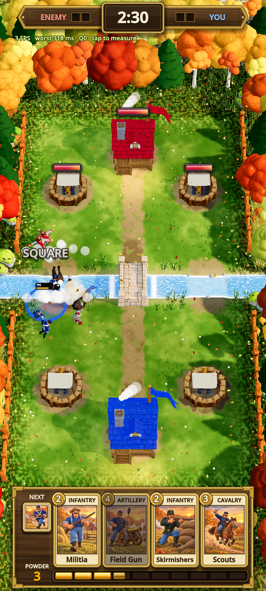

# Drums of War: art slice

A three-minute, portrait card battler set in the black-powder era: Union blue against
Confederate crimson. This folder is a **new, separate Godot 4.7 project**. It shares the
toolchain with Fatebound Siege (`../godot`) and none of its code, assets, package or keys.

This is stage 2 of the concept. Stage 1 was a grey box that proved the rules; this stage shows
the same match in the chosen art style: a 3D battlefield, generated character and prop models,
smoke, sound, and card portraits. The rules engine is unchanged.



## Run and test

```bash
GODOT=/path/to/Godot_v4.7.2-stable_linux.x86_64

$GODOT --path drums_of_war                      # play (desktop window, mouse = touch)
GODOT=$GODOT drums_of_war/tools/run_tests.sh    # all tests, headless, about 10 s

# Screenshots of a bot-versus-bot match on the real screen (needs a display):
xvfb-run -a $GODOT --rendering-method mobile --fixed-fps 30 --resolution 540x960 \
    --path drums_of_war -s tools/capture.gd

# Every generated model, fitted the way the game fits it (SHEET_NAMES=u_line,cannon to pick):
xvfb-run -a $GODOT --rendering-method mobile --resolution 540x960 \
    --path drums_of_war -s tools/model_sheet.gd
```

The test runner imports assets first when any are new; models, textures and sounds cannot be
loaded until Godot has imported them.

Android prototype APK (package `com.fatebound.drumsofwar.proto`, arm64, signed with a debug key
you supply; never the Fatebound preview key or the Play upload key):

```bash
GODOT=$GODOT ANDROID_HOME=/path/to/android-sdk KEYSTORE=/path/to/debug.keystore \
    drums_of_war/tools/build_preview.sh
```

Tests: `parse_all` (every script and scene loads), `rules_test` (73 checks of the rules below),
`bot_match_test` (24 full bot-versus-bot matches; `SEEDS=60` for more), `app_smoke_test`
(the real screen through real clicks: select, refused placement, deploy, a full match, rematch).

## How to play

Tap a card, then tap your half of the field (or tap a card and tap again to put it down).
Powder refills by itself, twice as fast in the last minute. Destroy the enemy Headquarters to
win outright; otherwise the side that has destroyed more redoubts wins on time, and a level
match goes to one minute of sudden-death overtime.

## What is in

| Rule | Where to look |
|---|---|
| Regiments fire in volleys, then reload. The first volley hits half again as hard. | `_fire_at_regiment`, `_volley_damage` |
| Hits in the same instant land together, so neither side gains from acting first. | `_deferring`, `_pending` |
| Nerve falls with losses, faster from flank fire and charges. At zero the regiment routs, runs for Headquarters and rallies there at half nerve. | `_damage`, `_update_rout` |
| Line Infantry forms square when cavalry closes. It takes 1.5 s, or 2.5 s if caught reloading. A formed square throws the charge back. | `_update_square`, `_melee` |
| Militia and Skirmishers cannot form square. | `can_square` in `data/cards.json` |
| The creek is crossed only at the bridge and two fords. Fords are 40% slower and nobody fires from the water. | `_waypoint`, `in_ford_water` |
| Field Gun roundshot ploughs through everything in its path and punishes columns and squares; grapeshot at close range. A gun runs out of ammunition after 35 s. | `_fire_gun` |
| A fallen enemy redoubt lets you deploy across the creek on that flank. | `deploy_depth` |
| Orders: Fire! (a regiment fires at once) and Rally (stop a rout, restore nerve). | `_play_order` |

## Layout

- `data/cards.json`: every card's numbers. Balancing is editing this file.
- `scripts/sim/battle_sim.gd`: the rules. Pure data at a fixed 20 steps a second with its own
  seeded random source, so the same seed and the same deploys always give the same battle.
- `scripts/sim/bot.gd`: the computer opponent. It plays through the same `deploy()` a player uses.
- `scripts/view/battle_screen.gd`: runs the match, takes input (tap a card then the field, or
  drag a card onto the field), plays sound, and lays out the HUD over the 3D view: a floating
  banner with the clock plaque, a floating card tray, framed strength bars over the structures
  and the outlined combat callouts.
- `scripts/view/ui_kit.gd`: the HUD's look in one place: palette, lettering, wood and brass,
  the banner and tray, the Powder trough, strength bars and the parchment card face. All of it
  is drawn in code; the wood grain is a generated noise texture.
- `scripts/view/card_view.gd`: one card in the hand as a node that animates itself with tweens:
  dealt in from the NEXT slot, a pulse when Powder first covers it, lift when chosen, and
  follow, tilt, shrink and a falling shadow while it is dragged.
- `scripts/view/battle_world.gd`: the 3D battlefield: structures, regiments in formation, smoke,
  flashes, lighting, and the camera that fits the field to whatever shape the screen is.
  It also makes blows land: camera shake, a brief hit-stop, muzzle light, shot streaks, shock
  rings, flung earth and splinters, struck figures flashing white and being shoved or thrown.
  At the start it loads and draws one of everything the decks can field behind a curtain,
  and it keeps figures built ahead of time, so a deploy does not stall the frame.
  The woods' shadow on the ground is drawn once at the start into a texture (the sun and the
  trees never move) rather than into the live shadow map every frame, and grass is only
  planted where the top-down camera can see the ground.
- `scripts/view/quality.gd`: watches the frame rate and, if it stays under the target, steps
  the finish down a level at a time (bloom and antialiasing, then shadow softness and model
  detail, then live shadows) until it holds. It is a safety net and slow to act: the game is
  built to run at level 0. The picture is never scaled down. The level is shown
  beside the FPS readout; tapping the readout starts again from the top.
  Per-pixel work is rationed, because a phone screen can have 4.6 million pixels: the fill
  and rim light come from a painted sky rather than two more lights, the porch lamps are
  painted by the ground shader, and the ground's five noises are read from two textures.
  The processor side is rationed too: the HUD's fixed furniture and its readouts are separate
  nodes redrawn only when they change, cards redraw only while they move, and in a crowded
  battle each soldier's skeleton is stepped every second or third frame, staggered.
- `scripts/view/bench.gd`: a cost meter that runs on the device. Tap the FPS readout: it turns
  each part of the picture off in turn, reads the engine's GPU and CPU render timers with and
  without it, and lists what each part costs per frame, heaviest first.
- `scripts/view/arena.gd`: the scenery, set in autumn: ground sculpted with a real creek channel,
  water, grass tufts and reeds, wheat, woods in fall colours, leaf litter and falling leaves,
  pumpkins and hay bales, drifting cloud shadow, sunbeams and motes, stepping stones. Units wade the fords and climb the
  bridge because the view asks it how high the ground is.
- `shaders/ground.gdshader`, `shaders/river.gdshader`: the striped lawn with its worn earth and
  sandy banks, and the creek with scrolling ripples, painted swirl lines and foam along the
  banks, over the fords and round the bridge.
- `scripts/view/musket_drill.gd`: makes infantry hold their muskets. It moves the musket through
  drill positions (shoulder, port, aim, recoil, load, charge) and places both hands on it with
  two-bone inverse kinematics, after the body clip has played.
- `scripts/view/models.gd`: hands out figures and props. A generated model is used when
  `assets/models/<name>/<name>.glb` exists; otherwise a primitive stand-in is built, so any card
  can be played before its model is made.
  Every model has a triangle budget (`BUDGET`) sized for how large it appears on the field, and
  is cut down to it once from the detail levels the importer builds: the engine's own
  distance-based choice kept far too many pixel-sized triangles on a dense phone screen.
- `assets/models/<name>/`: the model, the reference image it was generated from (`ref.png`),
  how it was made (`meta.json`), and for the farmhouse a crimson texture for the enemy's copy.
- `assets/audio/`: sound effects and the battle tune; `SOURCES.md` lists how each was made.
- `assets/cards/`: card pictures, made by `tools/make_card_art.py` from the painted action scenes
  in `assets/cards/src/`; `SOURCES.md` lists how each was made.
- `tests/`, `tools/`: headless tests, the test runner, screenshot and model-sheet tools, and
  `tools/prepare_model.py`, which shrinks a generated model's textures.

## How the art is made

1. A reference image per asset in the approved style: one subject on white, characters in an
   A-pose with empty hands.
2. Image-to-3D at a set triangle count, then auto-rigging for characters.
3. `tools/prepare_model.py` shrinks textures (and writes the crimson texture for structures);
   `models.gd` turns each model to face forward, scales it, and puts a musket in infantry hands.
4. Animation clips were made once, for the Union line infantryman, from the generator's
   library: a calm idle, march, run, panicked run, flinch, bayonet thrust, kneel, cheer,
   knockback and two falls. Every other rigged character borrows them, because the rigs share
   one skeleton. `models.gd` trims each library clip to its useful stretch and sets its pace.
5. Arms and musket are not animated by the clips at all: `musket_drill.gd` places them.

Cavalry are single unrigged models. A vertex shader swings everything below the horse's belly
fore and aft and rocks the body, which reads as a gallop at game distance; a real gait needs a
quadruped rig, which this stage does not have.

The game fills the screen on any shape of display (`window/stretch/aspect="expand"`); the HUD
is pinned to the top and bottom, clear of a notch or gesture bar, and the camera refits the field.

## Not in yet

The other ten cards of the 18-card launch deck, smoke as a rule (it is a visual effect only),
deck building, a menu, and online play. Known rough edges in this stage: the sounds were chosen
by measurement and have not been listened to; the cavalry crash sound is a stand-in mixed from other takes; the flinch and thrust clips
start from a side-on stance, so bodies swivel slightly into them. The Android APK builds
and is signed, but has not been run on a physical phone, and nothing here has been profiled on
one. Balance is the stage 1 first pass, tuned on bot-versus-bot matches.
