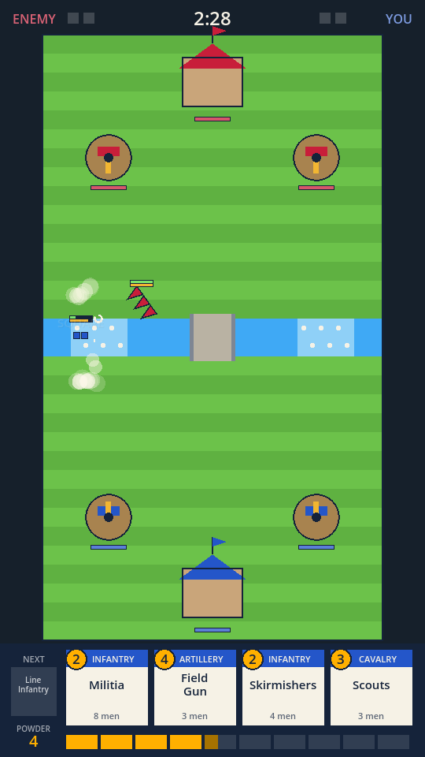

# Grapeshot (working title): grey-box prototype

A three-minute, portrait card battler set in the black-powder era: Union blue against
Confederate crimson. This folder is a **new, separate Godot 4.7 project**. It shares the
toolchain with Fatebound Siege (`../godot`) and none of its code, assets, package or keys.

This is stage 1 of the concept: one field, eight cards, a computer opponent, and plain shapes
for soldiers. Its only job is to answer whether volleys, routs and squares are fun.



## Run and test

```bash
GODOT=/path/to/Godot_v4.7.2-stable_linux.x86_64

$GODOT --path grapeshot                      # play (desktop window, mouse = touch)
GODOT=$GODOT grapeshot/tools/run_tests.sh    # all tests, headless, about 10 s

# Screenshots of a bot-versus-bot match on the real screen (needs a display):
xvfb-run -a $GODOT --rendering-method mobile --fixed-fps 30 --resolution 540x960 \
    --path grapeshot -s tools/capture.gd
```

Android prototype APK (package `com.fatebound.grapeshot.proto`, arm64, signed with a debug key
you supply; never the Fatebound preview key or the Play upload key):

```bash
GODOT=$GODOT ANDROID_HOME=/path/to/android-sdk KEYSTORE=/path/to/debug.keystore \
    grapeshot/tools/build_preview.sh
```

Tests: `parse_all` (every script and scene loads), `rules_test` (73 checks of the rules below),
`bot_match_test` (24 full bot-versus-bot matches; `SEEDS=60` for more), `app_smoke_test`
(the real screen through real clicks: select, refused placement, deploy, a full match, rematch).

## How to play

Tap a card, then tap your half of the field (or tap a card and tap again to put it down).
Powder refills by itself, twice as fast in the last minute. Destroy the enemy Headquarters to
win outright; otherwise the side that has destroyed more redoubts wins on time, and a level
match goes to one minute of sudden-death overtime.

## What is in

| Rule | Where to look |
|---|---|
| Regiments fire in volleys, then reload. The first volley hits half again as hard. | `_fire_at_regiment`, `_volley_damage` |
| Hits in the same instant land together, so neither side gains from acting first. | `_deferring`, `_pending` |
| Nerve falls with losses, faster from flank fire and charges. At zero the regiment routs, runs for Headquarters and rallies there at half nerve. | `_damage`, `_update_rout` |
| Line Infantry forms square when cavalry closes. It takes 1.5 s, or 2.5 s if caught reloading. A formed square throws the charge back. | `_update_square`, `_melee` |
| Militia and Skirmishers cannot form square. | `can_square` in `data/cards.json` |
| The creek is crossed only at the bridge and two fords. Fords are 40% slower and nobody fires from the water. | `_waypoint`, `in_ford_water` |
| Field Gun roundshot ploughs through everything in its path and punishes columns and squares; grapeshot at close range. A gun runs out of ammunition after 35 s. | `_fire_gun` |
| A fallen enemy redoubt lets you deploy across the creek on that flank. | `deploy_depth` |
| Orders: Fire! (a regiment fires at once) and Rally (stop a rout, restore nerve). | `_play_order` |

## Layout

- `data/cards.json`: every card's numbers. Balancing is editing this file.
- `scripts/sim/battle_sim.gd`: the rules. Pure data at a fixed 20 steps a second with its own
  seeded random source, so the same seed and the same deploys always give the same battle.
- `scripts/sim/bot.gd`: the computer opponent. It plays through the same `deploy()` a player uses.
- `scripts/view/battle_screen.gd`: draws the state with shapes and turns taps into deploys.
- `tests/`, `tools/`: headless tests, the test runner and the screenshot tool.

## Not in yet

The other ten cards of the 18-card launch deck, smoke as a rule (it is a visual effect only for
now), deck building, a menu, sound, any 3D art, and online play. The Android APK builds and is signed,
but has not yet been run on a physical phone. Balance is a
first pass tuned on bot-versus-bot matches: sides come out even (31 to 29 over 60 seeds), about
0.7 redoubts fall per match, and roughly a quarter of matches are decided in regular time.
