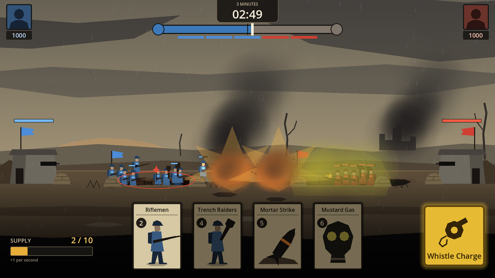

# No Man's Line

A 2D WWI tactical tug-of-war for mobile, built in Godot 4 (GDScript). All art is
procedural (`Polygon2D`, `ColorRect`, `Line2D`, `GPUParticles2D`), so the project
runs as-is with no imported assets.



## Run it

1. Open Godot 4.4 or newer, **Import** this folder (`project.godot`).
2. Press **F5**. The main scene is `scenes/Main.tscn`.

Controls: tap/click a card to play it. Mortar Strike and Mustard Gas arm a
targeting mode; tap the battlefield to fire, tap the card again (or right-click)
to cancel. The yellow button blows the whistle.

Project settings already applied in `project.godot`: 1920x1080 viewport,
stretch mode `canvas_items`, aspect `expand`, sensor-landscape orientation,
Mobile renderer, named 2D physics layers.

## Rules as implemented

| Thing | Behaviour |
| --- | --- |
| Supply | Both teams: +1 per second, max 10, start at 4. |
| Riflemen (2) | 3 infantry. Walk to the nearest trench that has a free slot and no enemy inside, take cover (bullets x0.4, mortars x0.5) and shoot across No Man's Land. |
| Trench Raiders (4) | 2 fast melee troops. x1.6 melee damage when fighting in a trench, x1.5 incoming damage on open ground. |
| Mortar Strike (5) | Targeted. Shell lands after 1.6 s, 70 to 25 damage over a 150 px radius, hits both teams, leaves a crater (cover zone, bullets x0.65) on open ground. |
| Mustard Gas (6) | Targeted, snaps onto a trench. 6 s cloud, 4 damage every 0.5 s to everyone inside, ignores cover. |
| Whistle Charge | Every Blue unit stationed in a trench sprints at the next enemy trench, or the enemy Command Bunker if no enemy trench is left. 8 s cooldown. |
| Bunkers | 1000 HP each, with a short-range machine gun. Destroying one ends the match at once. |
| Clock | 03:00. At 00:00 the side holding more of the 5 sectors wins. A sector tie goes to the healthier bunker, otherwise it is a stalemate. |
| Sectors | Bunker: its owner while it stands. Trench: last team to station a soldier in it with no enemy inside. No Man's Land: whoever has more soldiers standing in it. |

Balance numbers live in three places: `GameManager.CARDS` and its exported
properties, `Unit.STATS`, and the exported properties on Trench / Bunker /
MortarStrike / GasCloud / AIController.

## Scene trees

Collision layer / mask values are shown as `L` / `M` using the layer names below.

### Main.tscn

```
Main (Node2D)                        GameManager.gd
├─ Camera2D                          position (960, 540): centres the field on any aspect ratio
├─ Background (Node2D, z -10)
│  ├─ Sky, CloudLeft, CloudRight, CloudLow, DistantFire, FarRidge,
│  │  Ruins, RuinsLeft, MidRidge, Ground, MudStreakA, PuddleA, PuddleB   (Polygon2D)
│  ├─ DeadTreeA/B/C (+Branch), GroundEdge                                (Line2D)
│  └─ SmokeColumnA, SmokeColumnB                                         (GPUParticles2D)
├─ Battlefield (Node2D)
│  ├─ Sectors (Node2D)               the 5 zones, left to right
│  │  ├─ BlueBunker   (Bunker.tscn)  position (130, 700),  team = Blue
│  │  ├─ BlueTrench   (Trench.tscn)  position (600, 700),  initial_owner = Blue
│  │  ├─ NoMansLand   (Area2D)       position (960, 700),  L sectors, M blue_units + red_units
│  │  │  ├─ CollisionShape2D         RectangleShape2D 400 x 240
│  │  │  └─ ShellHoleA/B, StakeA/B (Polygon2D), Wire, WireLow (Line2D)
│  │  ├─ RedTrench    (Trench.tscn)  position (1320, 700), initial_owner = Red
│  │  └─ RedBunker    (Bunker.tscn)  position (1790, 700), team = Red
│  ├─ Craters (Node2D)               Crater.tscn instances are added here
│  ├─ Units (Node2D, y_sort_enabled) Unit.tscn instances are added here
│  └─ Effects (Node2D)               mortars, gas clouds, tracers
├─ Weather (Node2D, z 20)
│  ├─ Rain (GPUParticles2D)
│  └─ ForegroundMud (Polygon2D)
├─ MatchTimer (Timer)                one_shot, started from code with match_length
├─ SectorTimer (Timer)               0.25 s, autostart
├─ AIController (Node)               AIController.gd
│  └─ ThinkTimer (Timer)             started from code with think_interval
└─ HUD (HUD.tscn)
```

### Unit.tscn

```
Unit (CharacterBody2D)               Unit.gd, motion_mode = Floating, M none
├─ CollisionShape2D                  CapsuleShape2D (radius 12, height 76)
├─ Visual (Node2D)                   flipped with scale.x to face left / right
│  ├─ Shadow, LegBack, LegFront, Pack, Body, Armband, Head, Helmet (Polygon2D)
│  ├─ Rifle (Polygon2D)              shown for Riflemen
│  ├─ Club (Polygon2D)               shown for Trench Raiders
│  └─ Muzzle (Marker2D)
│     ├─ MuzzleFlash (Polygon2D)
│     └─ MuzzleSparks (GPUParticles2D, one_shot)
├─ VisionArea (Area2D)               L none, M = enemy unit layer (set in code)
│  └─ CollisionShape2D               CircleShape2D (radius set in code per unit type)
└─ HealthBar (Node2D)
   ├─ Back (ColorRect)
   └─ Fill (ColorRect)
```

The unit's own layer is set in `_ready()`: `collision_layer = 1 << team`.

### Trench.tscn

```
Trench (Area2D)                      Trench.gd, L sectors, M blue_units + red_units
├─ CollisionShape2D                  RectangleShape2D 330 x 220
├─ Visual (Node2D)                   drawn behind the soldiers
│  ├─ Pit, BackPlanks, PostLeft, PostMid, PostRight, Duckboards (Polygon2D)
│  └─ PlankGaps (Line2D)
├─ Flag (Node2D)
│  ├─ Pole (Polygon2D)
│  └─ Cloth (Polygon2D)              recoloured to the owning team
├─ Slots (Node2D)
│  └─ Slot0 .. Slot7 (Marker2D)      one firing position each: capacity = child count
└─ Parapet (Node2D, z 5)             drawn in front of the soldiers
   ├─ FrontLip, SandbagsLeft, SandbagsRight (Polygon2D)
   └─ LipHighlight, SandbagSeamsLeft/Right, WireLeft, WireRight (Line2D)
```

### HUD.tscn

```
HUD (CanvasLayer)                    HUD.gd
└─ Root (Control, full rect, mouse_filter Ignore)
   ├─ BottomShade (TextureRect)      GradientTexture2D behind the cards
   ├─ TopBar (Control)
   │  ├─ BluePanel (Control)  → Portrait (Panel → Head, Shoulders), ScoreLabel (Label)
   │  ├─ RedPanel (Control)   → Portrait (Panel → Head, Shoulders), ScoreLabel (Label)
   │  ├─ TimerPlate (Panel)   → CaptionLabel, TimerLabel (Label)
   │  └─ TugOfWar (Control)
   │     ├─ Frame, Back, BlueFill, CenterTick, Marker (ColorRect)
   │     ├─ BlueIcon, RedIcon (Panel)
   │     └─ SectorPips (HBoxContainer) → 5 x ColorRect, one per sector
   ├─ SupplyPanel (Control)   → TitleLabel, SupplyValue (Label), SupplyBar (ProgressBar), RateLabel
   ├─ TargetingOverlay (Control, full rect, hidden)   catches the battlefield tap
   │  ├─ Tint (ColorRect), HintLabel (Label)
   │  └─ Reticle (Node2D) → Ring, CrossH, CrossV (Line2D)
   ├─ CardHand (HBoxContainer)
   │  ├─ RiflemenCard (Button)
   │  │  ├─ NameLabel (Label), Divider (ColorRect)
   │  │  ├─ Art (Node2D → Polygon2D silhouette)
   │  │  ├─ CostBadge (Label)
   │  │  ├─ CooldownShade (ColorRect)
   │  │  └─ CooldownLabel (Label)
   │  ├─ RaidersCard (Button)        same children
   │  ├─ MortarCard (Button)         same children
   │  └─ GasCard (Button)            same children
   ├─ WhistleButton (Button)  → Icon (Node2D), TitleLabel (Label), CooldownShade (ColorRect)
   ├─ Banner (Label)
   └─ EndScreen (ColorRect, hidden)
      └─ Center (CenterContainer) → Box (VBoxContainer) → TitleLabel, ReasonLabel, RestartButton
```

`TargetingOverlay` must stay above `CardHand` in the tree (so it draws and
receives input underneath the cards) or the armed card cannot be tapped to cancel.

### Supporting scenes

```
Bunker (Area2D)            Bunker.gd, L sectors, M none
├─ CollisionShape2D        RectangleShape2D 190 x 130
├─ Visual (Node2D)         mirrored for Red
│  ├─ Mound, Wall, WallShade, Roof, Slit, Door, GunBarrel, Sandbags (Polygon2D), SandbagSeams (Line2D)
│  ├─ Flag (Node2D) → Pole, Cloth (Polygon2D)
│  ├─ Muzzle (Marker2D) → MuzzleFlash (Polygon2D)
│  └─ SpawnPoint (Marker2D)
├─ GunRange (Area2D)       L none, M = enemy unit layer (set in code) → CollisionShape2D
├─ GunTimer (Timer)        autostart
├─ HealthBar (Node2D) → Back, Fill (ColorRect)
└─ WreckSmoke (GPUParticles2D)

MortarStrike (Node2D)      MortarStrike.gd
├─ TargetMarker (Node2D) → Ring (Line2D), FlareStick, Flare (Polygon2D)
├─ Shell, Blast (Polygon2D)
├─ Debris, Smoke (GPUParticles2D, one_shot)
└─ FuseTimer (Timer, one_shot)

GasCloud (Area2D)          GasCloud.gd, L hazards, M blue_units + red_units
├─ CollisionShape2D        RectangleShape2D 340 x 220
├─ Haze (Polygon2D), Puffs (GPUParticles2D)
└─ TickTimer, LifeTimer (Timer)

Crater (StaticBody2D)      Crater.gd, L cover, M none
├─ CollisionShape2D        RectangleShape2D 120 x 16
├─ Rim, Pit, Scorch (Polygon2D)
└─ CoverZone (Area2D)      L none, M blue_units + red_units → CollisionShape2D
```

## Editor setup

Everything below is already saved in the `.tscn` files and `project.godot`.
Use it as a checklist if you rebuild a scene by hand.

### Collision layers

Project Settings → Layer Names → 2D Physics:

| Layer | Name | Who is on it | Who scans for it (mask) |
| --- | --- | --- | --- |
| 1 | `blue_units` | Blue `Unit` bodies | Red `VisionArea`, Red bunker `GunRange`, Trench, NoMansLand, GasCloud, Crater `CoverZone` |
| 2 | `red_units` | Red `Unit` bodies | Blue `VisionArea`, Blue bunker `GunRange`, Trench, NoMansLand, GasCloud, Crater `CoverZone` |
| 3 | `cover` | `Crater` (StaticBody2D) | nobody |
| 4 | `sectors` | `Trench`, `NoMansLand`, `Bunker` | nobody |
| 5 | `hazards` | `GasCloud` | nobody |

Units have mask 0, so soldiers never block each other. Their layer exists only so
that `Area2D` nodes can detect them. Team-dependent layers and masks (the unit's
own layer, `VisionArea`, `GunRange`) are assigned in `_ready()`, so you do not set
them per instance.

### Signals connected in the editor

| Scene | From | Signal | To | Method |
| --- | --- | --- | --- | --- |
| Main | `MatchTimer` | `timeout` | `Main` | `_on_match_timer_timeout` |
| Main | `SectorTimer` | `timeout` | `Main` | `_on_sector_timer_timeout` |
| Main | `BlueBunker`, `RedBunker` | `destroyed` | `Main` | `_on_bunker_destroyed` |
| Main | `BlueBunker`, `RedBunker` | `health_changed` | `Main` | `_on_bunker_health_changed` |
| Main | `BlueTrench`, `RedTrench` | `owner_changed` | `Main` | `_on_trench_owner_changed` |
| Main | `AIController/ThinkTimer` | `timeout` | `AIController` | `_on_think_timer_timeout` |
| Main | `Main` | `supply_changed` | `HUD` | `_on_supply_changed` |
| Main | `Main` | `time_changed` | `HUD` | `_on_time_changed` |
| Main | `Main` | `sector_control_changed` | `HUD` | `_on_sector_control_changed` |
| Main | `Main` | `bunker_health_changed` | `HUD` | `_on_bunker_health_changed` |
| Main | `Main` | `whistle_charge` | `HUD` | `_on_whistle_charge` |
| Main | `Main` | `match_ended` | `HUD` | `_on_match_ended` |
| HUD | each card `Button` | `pressed` | `HUD` | `_on_card_pressed`, with one extra `int` argument: 0, 1, 2, 3 |
| HUD | `WhistleButton` | `pressed` | `HUD` | `_on_whistle_button_pressed` |
| HUD | `TargetingOverlay` | `gui_input` | `HUD` | `_on_targeting_overlay_gui_input` |
| HUD | `RestartButton` | `pressed` | `HUD` | `_on_restart_button_pressed` |
| Trench | `Trench` | `body_entered` / `body_exited` | `Trench` | `_on_body_entered` / `_on_body_exited` |
| Bunker | `GunTimer` | `timeout` | `Bunker` | `_on_gun_timer_timeout` |
| MortarStrike | `FuseTimer` | `timeout` | `MortarStrike` | `_on_fuse_timer_timeout` |
| GasCloud | `TickTimer`, `LifeTimer` | `timeout` | `GasCloud` | `_on_tick_timer_timeout`, `_on_life_timer_timeout` |
| Crater | `CoverZone` | `body_entered` / `body_exited` | `Crater` | `_on_cover_zone_body_entered` / `_on_cover_zone_body_exited` |

The card id is added in the Connect dialog under **Advanced → Extra Call
Arguments** (type `int`). It matches `GameManager.Card`: 0 Riflemen, 1 Raiders,
2 Mortar, 3 Gas.

Connected in code instead: every `Unit` connects itself to
`GameManager.whistle_charge` in `_ready()`, because units are spawned at runtime.

### Things that break the scene if changed

- `Unit.setup(game, team, type)` must be called before `add_child()`.
- Decorative `ColorRect` / `Panel` nodes inside buttons need **Mouse → Filter:
  Ignore**, or they swallow the tap.
- Each trench slot is a `Marker2D` directly under `Slots`. Add or remove markers
  to change capacity.
- `Units` needs `y_sort_enabled`, and `Parapet` needs `z_index = 5`, for soldiers
  to look like they are standing inside the trench.

## Scripts

| File | Role |
| --- | --- |
| `scripts/GameManager.gd` | Match clock, Supply, card play, whistle signal, sector control, win / loss. |
| `scripts/Unit.gd` | Soldier state machine: `MARCHING`, `IN_COVER`, `CHARGING`, `ATTACKING`, `DEAD`. |
| `scripts/Trench.gd` | Slot reservation, cover multipliers, sector ownership. |
| `scripts/AIController.gd` | Red's decision loop: `BUILD_UP`, `DEFEND`, `ASSAULT`, plus opportunistic mortars and gas. |
| `scripts/HUD.gd` | Cards, cooldown wipes, tug-of-war bar, touch targeting, end screen. |
| `scripts/Bunker.gd` | Command Bunker health, machine gun, spawn point. |
| `scripts/MortarStrike.gd`, `GasCloud.gd`, `Crater.gd` | The two abilities and the crater they leave. |

## Smoke test

`tools/smoke_test.gd` plays full matches headless with an AI on both sides:

```
godot --headless --path . --import
godot --headless --path . -s tools/smoke_test.gd -- 3
```

It prints one `MATCH:` line per game and `SMOKE TEST PASSED` at the end.
