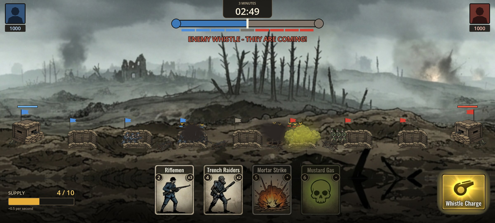

# No Man's Line

A 2D WWI tactical tug-of-war for mobile, built in Godot 4 (GDScript). Soldiers,
bunkers, trenches, props, the backdrop, the four cards and the whistle button
come from two sprite sheets in `assets/`.



## Run it

1. Open Godot 4.4 or newer, **Import** this folder (`project.godot`).
2. Press **F5**. The main scene is `scenes/Main.tscn`.

Controls: tap/click a card to play it. Mortar Strike and Mustard Gas arm a
targeting mode; tap the battlefield to fire, tap the card again (or right-click)
to cancel. The gold button blows the whistle.

### Android build

`export_presets.cfg` has an **Android** preset: package `com.nomansline.preview`,
arm64-v8a, sensor landscape, immersive mode. In the editor: install the Android
export templates, set the Android SDK and JDK paths and a debug keystore under
Editor Settings → Export → Android, then Project → Export → Android. From a shell:

```
godot --headless --path . --export-debug "Android" build/NoMansLine.apk
```

The APK is a debug-signed preview, not a store build.

## Rules as implemented

| Thing | Behaviour |
| --- | --- |
| Supply | Both teams: +1 per second, max 10, start at 4. |
| Riflemen (2) | 3 infantry. Walk to the nearest trench that has a free slot and no enemy inside, take cover (bullets x0.4, mortars x0.5) and shoot across No Man's Land. |
| Trench Raiders (4) | 2 fast melee troops. x1.6 melee damage when fighting in a trench, x1.5 incoming damage on open ground. |
| Mortar Strike (5) | Targeted. Shell lands after 1.6 s, 70 to 25 damage over a 150 px radius, hits both teams, leaves a crater (cover zone, bullets x0.65) on open ground. |
| Mustard Gas (6) | Targeted, snaps onto a trench. 6 s cloud, 4 damage every 0.5 s to everyone inside, ignores cover. |
| Whistle Charge | Every Blue unit stationed in a trench sprints at the next enemy trench, or the enemy Command Bunker if no enemy trench is left. 8 s cooldown. |
| Bunkers | 1000 HP each, with a short-range machine gun. Switch to the damaged art at 40% health. Destroying one ends the match at once. |
| Clock | 03:00. At 00:00 the side holding more of the 5 sectors wins. A sector tie goes to the healthier bunker, otherwise it is a stalemate. |
| Sectors | Bunker: its owner while it stands. Trench: last team to station a soldier in it with no enemy inside. No Man's Land: whoever has more soldiers standing in it. |

Balance numbers live in three places: `GameManager.CARDS` and its exported
properties, `Unit.STATS`, and the exported properties on Trench / Bunker /
MortarStrike / GasCloud / AIController.

## Art pipeline

```
assets/
├─ source/                     the two sheets as delivered (ignored by Godot via .gdignore)
├─ units_sheet.png             background removed, 1408 x 768
├─ environment_ui_sheet.png    background removed, 1376 x 768
├─ atlas/*.tres                one AtlasTexture per prop / card / button
└─ sprites/*.tres              one SpriteFrames per soldier type
```

### 1. Removing the gray background

Godot's Import dock has no colour-key option, so there are two ways.

**Bake it once (what this project does).** `tools/strip_background.gd` flood-fills
inward from the image border and writes a PNG with real alpha:

```
godot --headless --path . -s tools/strip_background.gd -- \
    assets/source/units_sheet.jpg assets/units_sheet.png --holes --erase=1238,56,26,28
godot --headless --path . -s tools/strip_background.gd -- \
    assets/source/environment_ui_sheet.jpg assets/environment_ui_sheet.png --keep=0,18,1376,259
```

- `--holes` also clears enclosed pockets of background (inside the barbed wire
  coils, between arms and bodies).
- `--keep` protects the panoramic banner, which is full-bleed art with no
  background of its own.
- `--erase` clears the tip of one muzzle flash that pokes into the next frame's
  rectangle (see "Gaps in the sheets").
- The backdrop measured `#323232` / `#303030`, not `#373737`. The tool samples it
  from the bottom-left corner; pass `--key=RRGGBB` to override.

**Shader (quick, no preprocessing).** `shaders/chroma_key.gdshader` sets alpha to 0
by `color_distance` to the key colour. Put it in a ShaderMaterial on any node that
draws a raw sheet. It is included but not used, because a colour key cannot tell
background from sprite: on these sheets it also deletes coat and timber shading
that matches the backdrop gray, and it eats into the banner's mud.

### 2. Import and filter settings

Already applied; listed so you can reproduce them.

- **Filter** is no longer an import option in Godot 4. It is
  Project Settings → Rendering → Textures → Canvas Textures → **Default Texture
  Filter**. This project uses **Linear Mipmap**, because the painted sprites are
  drawn at about half size. Use **Nearest** only for pixel art. A single node can
  override it under CanvasItem → Texture → Filter.
- Select each sheet in the FileSystem dock → Import dock → **Mipmaps → Generate:
  On** → Reimport. Leave **Fix Alpha Border** on (it stops dark fringes on
  transparent edges).
- Every AtlasTexture has **Filter Clip** on so a region never blends with its
  neighbour on the sheet.

### 3. Slicing

**Static props, cards, buttons: `AtlasTexture`.** In the FileSystem dock:
right-click → New Resource → AtlasTexture, set **Atlas** to the sheet, click
**Edit Region** and drag a box (or type the Rect2). Save it as `.tres` and assign
it to `Sprite2D.texture`, `TextureButton.texture_normal`, and so on.

`environment_ui_sheet.png` regions (x, y, w, h):

| Resource | Region | Used by |
| --- | --- | --- |
| `background_banner` | 0, 18, 1376, 259 | `Main/Background/Banner` |
| `bunker_intact` | 42, 307, 288, 226 | `Bunker/Visual/Sprite` |
| `bunker_damaged` | 355, 307, 288, 226 | Bunker at 40% health and when destroyed |
| `trench_bay` | 1105, 303, 214, 96 | `Trench/Bay` (wall behind the soldiers) |
| `trench_parapet` | 1118, 303, 196, 34 | `Trench/Parapet/Sandbags` (in front of them) |
| `trench_walkway` | 655, 303, 220, 109 | sliced, not placed |
| `trench_corner` | 893, 303, 206, 102 | sliced, not placed |
| `mortar_cannon` | 671, 420, 124, 143 | `Bunker/Visual/MortarProp` |
| `mortar_shell` | 870, 458, 35, 95 | `MortarStrike/Shell` |
| `flare` | 985, 417, 162, 140 | `MortarStrike/TargetMarker/Flare` |
| `gas_cloud` | 1174, 413, 149, 150 | `GasCloud/Clouds/*` |
| `card_riflemen` | 367, 578, 144, 179 | `HUD/.../RiflemenCard` |
| `card_raiders` | 534, 578, 142, 179 | `HUD/.../RaidersCard` |
| `card_mortar` | 700, 578, 142, 179 | `HUD/.../MortarCard` |
| `card_gas` | 865, 578, 144, 179 | `HUD/.../GasCard` |
| `whistle_button` | 1150, 577, 218, 187 | `HUD/Root/WhistleButton` |

`units_sheet.png` props:

| Resource | Region | Used by |
| --- | --- | --- |
| `barbed_wire` | 1113, 560, 255, 176 | No Man's Land and trench flanks |
| `muzzle_flash` | 646, 566, 44, 32 | `Unit/Muzzle/MuzzleFlash`, bunker gun |
| `bunker_units_sheet` | 748, 503, 327, 250 | sliced, not placed (the environment sheet's intact / damaged pair is used) |

**Soldiers: `SpriteFrames` in an `AnimatedSprite2D`.** The frames are not on a
regular grid, so "Add Frames from Sprite Sheet" does not fit. Each frame is an
AtlasTexture with a tight **Region** plus a **Margin** that pads it out to one
shared cell size, with the feet on the bottom edge and the body on the centre
line. That keeps the soldier from jumping between frames of different widths and
makes `flip_h` mirror around the body.

| SpriteFrames | Cell | Animation | Frames (regions on `units_sheet.png`) |
| --- | --- | --- | --- |
| `blue_rifleman` | 282 x 199 | `walk` 7 fps, loop | (37,29,141,197) (183,28,93,197) (317,29,115,197) (460,29,143,197) |
| | | `cover` | (617,62,217,163) kneeling |
| | | `aim` | (894,37,172,189) |
| | | `attack` 7 fps, once | fire (1070,37,168,189) → recoil (1238,37,152,189) → aim |
| `blue_raider` | 244 x 235 | `walk` 9 fps, loop | (34,295,131,188) (183,295,144,189) (347,297,151,187) (514,298,133,185) |
| | | `cover` | (745,326,199,155) crouching |
| | | `aim` | (1175,295,172,189) shotgun |
| | | `attack` 5 fps, once | club swing (965,252,181,233) → shotgun |
| `red_rifleman` | 332 x 206 | `walk` | Blue's four walk frames (repainted at runtime) |
| | | `cover`, `aim` | (56,533,179,204) |
| | | `attack` 7 fps, once | fire (474,533,216,204) → (277,533,179,204) → aim |

To add or change a frame in the editor: open the `.tres`, pick the animation in
the SpriteFrames panel, select a frame, and edit its AtlasTexture Region in the
Inspector. Keep `region.size + margin.size` equal to the cell size.

### Gaps in the sheets

- **No Red walk cycle, no Red raiders.** Red reuses Blue's frames for those, and
  `shaders/team_recolor.gdshader` repaints the blue-gray uniform olive green while
  a borrowed animation plays. Red riflemen therefore change helmet shape between
  walking and shooting. `Unit.LOOKS` is the one place to change when Red art exists.
- **No Red cover frame.** Stationed Red riflemen stand in their aiming pose.
- **Card numbers.** The card art shows costs 2 / 2 / 3 / 4; the rules are
  2 / 4 / 5 / 6. The HUD draws the live cost over the left badge and squad size
  (or a cooldown countdown) over the right badge, so the game always shows the
  real numbers.
- **Overlapping frames.** Blue's "fire" muzzle flash reaches into the next frame's
  rectangle. The tip is erased by the strip tool and every shot gets the separate
  `muzzle_flash` sprite instead.
- **Still procedural:** unit shadows and health bars, ownership flags, craters,
  the explosion flash, tracers, rain, and the top bar (portraits, tug-of-war bar,
  supply bar). The sheets have no art for them.

## Scene trees

Collision layer / mask values are shown as `L` / `M` using the layer names below.

### Main.tscn

```
Main (Node2D)                        GameManager.gd
├─ Camera2D                          position (960, 540): centres the field on any aspect ratio
├─ Background (Node2D, z -10)
│  ├─ SkyFill, GroundFill (Polygon2D) flat colour above and below the banner
│  ├─ Banner (Sprite2D)              background_banner, scale 1.85 (covers up to 21:9)
│  └─ SkyFade, GroundFade (Polygon2D) alpha gradients that hide the banner's edges
├─ Battlefield (Node2D)
│  ├─ Sectors (Node2D)               the 5 zones, left to right
│  │  ├─ BlueBunker   (Bunker.tscn)  position (130, 700),  team = Blue
│  │  ├─ BlueTrench   (Trench.tscn)  position (600, 700),  initial_owner = Blue
│  │  ├─ NoMansLand   (Area2D)       position (960, 700),  L sectors, M blue_units + red_units
│  │  │  ├─ CollisionShape2D         RectangleShape2D 400 x 240
│  │  │  └─ WireA, WireB (Sprite2D)  barbed_wire
│  │  ├─ RedTrench    (Trench.tscn)  position (1320, 700), initial_owner = Red
│  │  └─ RedBunker    (Bunker.tscn)  position (1790, 700), team = Red
│  ├─ Craters (Node2D)               Crater.tscn instances are added here
│  ├─ Units (Node2D, y_sort_enabled) Unit.tscn instances are added here
│  └─ Effects (Node2D)               mortars, gas clouds, tracers
├─ Weather (Node2D, z 20)
│  └─ Rain (GPUParticles2D)
├─ MatchTimer (Timer)                one_shot, started from code with match_length
├─ SectorTimer (Timer)               0.25 s, autostart
├─ AIController (Node)               AIController.gd
│  └─ ThinkTimer (Timer)             started from code with think_interval
└─ HUD (HUD.tscn)
```

### Unit.tscn

```
Unit (CharacterBody2D)               Unit.gd, motion_mode = Floating, M none
├─ CollisionShape2D                  CapsuleShape2D (radius 14, height 90)
├─ Shadow (Polygon2D)
├─ Sprite (AnimatedSprite2D)         sprite_frames, scale and offset are set in code per team / type
├─ Muzzle (Marker2D)                 rifle tip; mirrored in code when the unit faces left
│  ├─ MuzzleFlash (Sprite2D)         muzzle_flash
│  └─ MuzzleSparks (GPUParticles2D, one_shot)
├─ VisionArea (Area2D)               L none, M = enemy unit layer (set in code)
│  └─ CollisionShape2D               CircleShape2D (radius set in code per unit type)
└─ HealthBar (Node2D)
   ├─ Back (ColorRect)
   └─ Fill (ColorRect)
```

The unit's own layer is set in `_ready()`: `collision_layer = 1 << team`.

How `Unit.gd` drives the sprite:

| State | Animation |
| --- | --- |
| `MARCHING`, `CHARGING` | `walk` (faster when sprinting, paused while standing still) |
| `IN_COVER` | `cover` |
| `ATTACKING` | `aim` between attacks, `walk` while a raider chases its target |
| each shot or swing | `attack` once, then back to the state's animation |

`state` has a setter, so every `state = ...` assignment switches animation
immediately. The art faces right: `sprite.flip_h = _facing < 0`, which leaves Blue
as drawn and mirrors Red; a unit also turns to face its target.

### Trench.tscn

```
Trench (Area2D)                      Trench.gd, L sectors, M blue_units + red_units
├─ CollisionShape2D                  RectangleShape2D 330 x 220
├─ Bay (Sprite2D)                    trench_bay, drawn behind the soldiers
├─ Flag (Node2D)
│  ├─ Pole (Polygon2D)
│  └─ Cloth (Polygon2D)              recoloured to the owning team
├─ Slots (Node2D)
│  └─ Slot0 .. Slot7 (Marker2D)      one firing position each: capacity = child count
└─ Parapet (Node2D, z 5)             drawn in front of the soldiers
   ├─ Sandbags (Sprite2D)            trench_parapet
   └─ WireLeft, WireRight (Sprite2D) barbed_wire
```

### HUD.tscn

```
HUD (CanvasLayer)                    HUD.gd
└─ Root (Control, full rect, mouse_filter Ignore)
   ├─ BottomShade (TextureRect)      GradientTexture2D behind the cards
   ├─ TopBar (Control)
   │  ├─ BluePanel (Control)  → Portrait (Panel → Head, Shoulders), ScoreLabel (Label)
   │  ├─ RedPanel (Control)   → Portrait (Panel → Head, Shoulders), ScoreLabel (Label)
   │  ├─ TimerPlate (Panel)   → CaptionLabel, TimerLabel (Label)
   │  └─ TugOfWar (Control)
   │     ├─ Frame, Back, BlueFill, CenterTick, Marker (ColorRect)
   │     ├─ BlueIcon, RedIcon (Panel)
   │     └─ SectorPips (HBoxContainer) → 5 x ColorRect, one per sector
   ├─ SupplyPanel (Control)   → TitleLabel, SupplyValue (Label), SupplyBar (ProgressBar), RateLabel
   ├─ TargetingOverlay (Control, full rect, hidden)   catches the battlefield tap
   │  ├─ Tint (ColorRect), HintLabel (Label)
   │  └─ Reticle (Node2D) → Ring, CrossH, CrossV (Line2D)
   ├─ CardHand (HBoxContainer)
   │  ├─ RiflemenCard (TextureButton)      texture_normal = card_riflemen
   │  │  ├─ CooldownWipe (TextureProgressBar)  same texture, tinted black, fills bottom to top
   │  │  ├─ CostBadge (Label)              live cost, over the art's left badge
   │  │  └─ InfoBadge (Label)              squad size / "+" / cooldown seconds, over the right badge
   │  ├─ RaidersCard (TextureButton)       card_raiders, same children
   │  ├─ MortarCard (TextureButton)        card_mortar, same children
   │  └─ GasCard (TextureButton)           card_gas, same children
   ├─ WhistleButton (TextureButton)        texture_normal = whistle_button
   │  └─ CooldownWipe (TextureProgressBar)
   ├─ Banner (Label)
   └─ EndScreen (ColorRect, hidden)
      └─ Center (CenterContainer) → Box (VBoxContainer) → TitleLabel, ReasonLabel, RestartButton
```

TextureButton settings: **Ignore Texture Size** on, **Stretch Mode** Keep Aspect
Centered, `custom_minimum_size` 200 x 250 for cards. The sheets have no
pressed / hover / disabled art, so `HUD.gd` tints the button instead (dim when
unaffordable, gold when armed, darker while held).

`TargetingOverlay` must stay above `CardHand` in the tree (so it draws and
receives input underneath the cards) or the armed card cannot be tapped to cancel.

### Supporting scenes

```
Bunker (Area2D)            Bunker.gd, L sectors, M none; exports intact_texture / damaged_texture
├─ CollisionShape2D        RectangleShape2D 190 x 130
├─ Visual (Node2D)         scale.x = -1 for Red, which also mirrors the markers
│  ├─ MortarProp (Sprite2D)   mortar_cannon, kicks when the team fires a shell
│  ├─ Sprite (Sprite2D)       bunker_intact / bunker_damaged
│  ├─ Flag (Node2D) → Pole, Cloth (Polygon2D)
│  ├─ Muzzle (Marker2D) → MuzzleFlash (Sprite2D)
│  └─ SpawnPoint (Marker2D)
├─ GunRange (Area2D)       L none, M = enemy unit layer (set in code) → CollisionShape2D
├─ GunTimer (Timer)        autostart
├─ HealthBar (Node2D) → Back, Fill (ColorRect)
└─ WreckSmoke (GPUParticles2D)

MortarStrike (Node2D)      MortarStrike.gd
├─ TargetMarker (Node2D) → Ring (Line2D), Flare (Sprite2D, flare)
├─ Shell (Sprite2D)        mortar_shell
├─ Blast (Polygon2D)
├─ Debris, Smoke (GPUParticles2D, one_shot)
└─ FuseTimer (Timer, one_shot)

GasCloud (Area2D)          GasCloud.gd, L hazards, M blue_units + red_units
├─ CollisionShape2D        RectangleShape2D 340 x 220
├─ Clouds (Node2D) → CloudLeft, CloudRight, CloudMid (Sprite2D, gas_cloud)
├─ Puffs (GPUParticles2D)
└─ TickTimer, LifeTimer (Timer)

Crater (StaticBody2D)      Crater.gd, L cover, M none
├─ CollisionShape2D        RectangleShape2D 120 x 16
├─ Rim, Pit, Scorch (Polygon2D)
└─ CoverZone (Area2D)      L none, M blue_units + red_units → CollisionShape2D
```

## Editor setup

Everything below is already saved in the `.tscn` files and `project.godot`.
Use it as a checklist if you rebuild a scene by hand.

### Collision layers

Project Settings → Layer Names → 2D Physics:

| Layer | Name | Who is on it | Who scans for it (mask) |
| --- | --- | --- | --- |
| 1 | `blue_units` | Blue `Unit` bodies | Red `VisionArea`, Red bunker `GunRange`, Trench, NoMansLand, GasCloud, Crater `CoverZone` |
| 2 | `red_units` | Red `Unit` bodies | Blue `VisionArea`, Blue bunker `GunRange`, Trench, NoMansLand, GasCloud, Crater `CoverZone` |
| 3 | `cover` | `Crater` (StaticBody2D) | nobody |
| 4 | `sectors` | `Trench`, `NoMansLand`, `Bunker` | nobody |
| 5 | `hazards` | `GasCloud` | nobody |

Units have mask 0, so soldiers never block each other. Their layer exists only so
that `Area2D` nodes can detect them. Team-dependent layers and masks (the unit's
own layer, `VisionArea`, `GunRange`) are assigned in `_ready()`, so you do not set
them per instance.

### Signals connected in the editor

| Scene | From | Signal | To | Method |
| --- | --- | --- | --- | --- |
| Main | `MatchTimer` | `timeout` | `Main` | `_on_match_timer_timeout` |
| Main | `SectorTimer` | `timeout` | `Main` | `_on_sector_timer_timeout` |
| Main | `BlueBunker`, `RedBunker` | `destroyed` | `Main` | `_on_bunker_destroyed` |
| Main | `BlueBunker`, `RedBunker` | `health_changed` | `Main` | `_on_bunker_health_changed` |
| Main | `BlueTrench`, `RedTrench` | `owner_changed` | `Main` | `_on_trench_owner_changed` |
| Main | `AIController/ThinkTimer` | `timeout` | `AIController` | `_on_think_timer_timeout` |
| Main | `Main` | `supply_changed` | `HUD` | `_on_supply_changed` |
| Main | `Main` | `time_changed` | `HUD` | `_on_time_changed` |
| Main | `Main` | `sector_control_changed` | `HUD` | `_on_sector_control_changed` |
| Main | `Main` | `bunker_health_changed` | `HUD` | `_on_bunker_health_changed` |
| Main | `Main` | `whistle_charge` | `HUD` | `_on_whistle_charge` |
| Main | `Main` | `match_ended` | `HUD` | `_on_match_ended` |
| HUD | each card `TextureButton` | `pressed` | `HUD` | `_on_card_pressed`, with one extra `int` argument: 0, 1, 2, 3 |
| HUD | `WhistleButton` | `pressed` | `HUD` | `_on_whistle_button_pressed` |
| HUD | `TargetingOverlay` | `gui_input` | `HUD` | `_on_targeting_overlay_gui_input` |
| HUD | `RestartButton` | `pressed` | `HUD` | `_on_restart_button_pressed` |
| Unit | `Sprite` | `animation_finished` | `Unit` | `_on_sprite_animation_finished` |
| Trench | `Trench` | `body_entered` / `body_exited` | `Trench` | `_on_body_entered` / `_on_body_exited` |
| Bunker | `GunTimer` | `timeout` | `Bunker` | `_on_gun_timer_timeout` |
| MortarStrike | `FuseTimer` | `timeout` | `MortarStrike` | `_on_fuse_timer_timeout` |
| GasCloud | `TickTimer`, `LifeTimer` | `timeout` | `GasCloud` | `_on_tick_timer_timeout`, `_on_life_timer_timeout` |
| Crater | `CoverZone` | `body_entered` / `body_exited` | `Crater` | `_on_cover_zone_body_entered` / `_on_cover_zone_body_exited` |

The card id is added in the Connect dialog under **Advanced → Extra Call
Arguments** (type `int`). It matches `GameManager.Card`: 0 Riflemen, 1 Raiders,
2 Mortar, 3 Gas.

Connected in code instead: every `Unit` connects itself to
`GameManager.whistle_charge` in `_ready()`, because units are spawned at runtime.

### Things that break the scene if changed

- `Unit.setup(game, team, type)` must be called before `add_child()`.
- Every SpriteFrames needs the four animations `walk`, `cover`, `aim`, `attack`,
  and `attack` must have **Loop off** or the unit never returns to its state pose.
- Badge labels and `CooldownWipe` inside the buttons need **Mouse → Filter:
  Ignore** (Labels default to it), or they swallow the tap.
- Each trench slot is a `Marker2D` directly under `Slots`. Add or remove markers
  to change capacity.
- `Units` needs `y_sort_enabled`, and `Parapet` needs `z_index = 5`, for soldiers
  to stand behind the sandbags.
- If you replace a sheet with one of a different size or layout, every Region
  above has to be redone.

## Scripts

| File | Role |
| --- | --- |
| `scripts/GameManager.gd` | Match clock, Supply, card play, whistle signal, sector control, win / loss. |
| `scripts/Unit.gd` | Soldier state machine (`MARCHING`, `IN_COVER`, `CHARGING`, `ATTACKING`, `DEAD`) and its animations. |
| `scripts/Trench.gd` | Slot reservation, cover multipliers, sector ownership. |
| `scripts/AIController.gd` | Red's decision loop: `BUILD_UP`, `DEFEND`, `ASSAULT`, plus opportunistic mortars and gas. |
| `scripts/HUD.gd` | Cards, cooldown wipes, tug-of-war bar, touch targeting, end screen. |
| `scripts/Bunker.gd` | Command Bunker health, intact / damaged art, machine gun, spawn point. |
| `scripts/MortarStrike.gd`, `GasCloud.gd`, `Crater.gd` | The two abilities and the crater they leave. |
| `shaders/team_recolor.gdshader` | Repaints borrowed Blue frames for Red. |
| `shaders/chroma_key.gdshader` | Optional colour-key background removal (unused). |
| `tools/strip_background.gd` | Bakes transparency into a sheet. |

## Smoke test

`tools/smoke_test.gd` plays full matches headless with an AI on both sides:

```
godot --headless --path . --import
godot --headless --path . -s tools/smoke_test.gd -- 3
```

It prints one `MATCH:` line per game and `SMOKE TEST PASSED` at the end.
